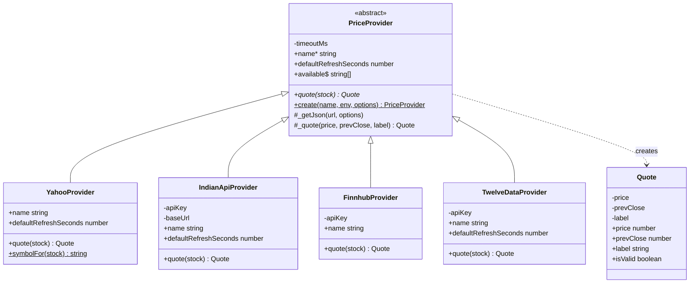
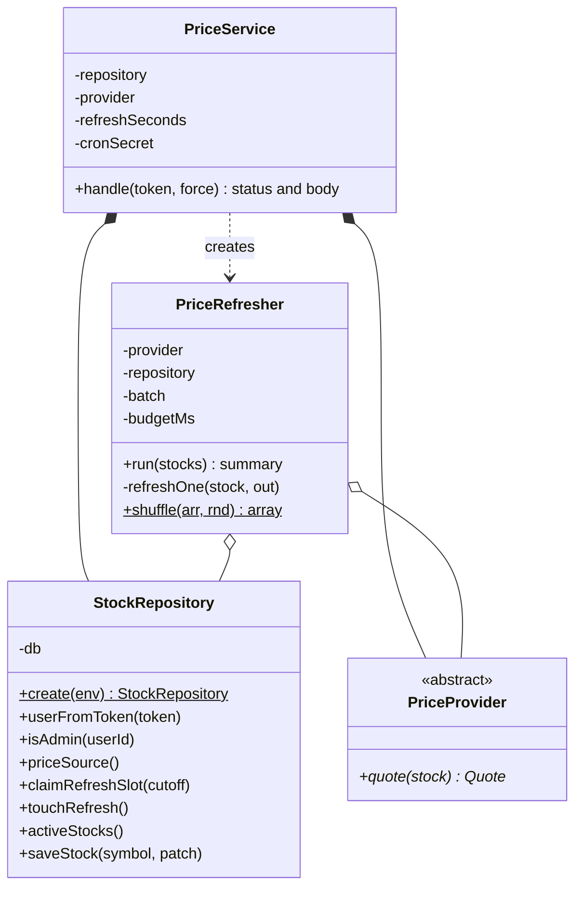
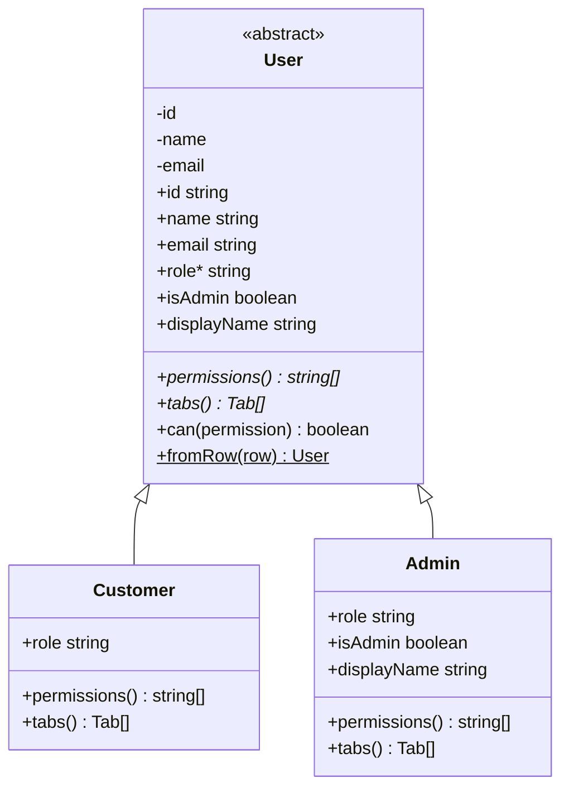
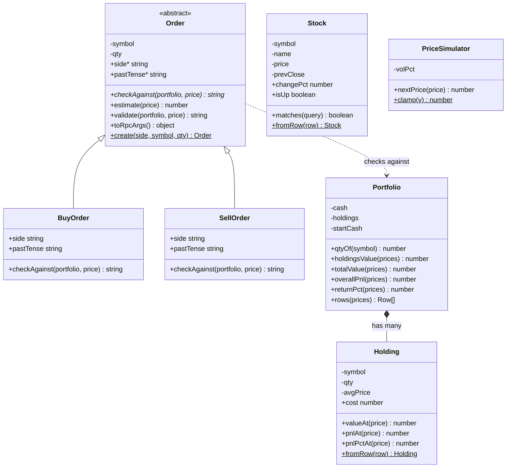

# Stockify: UML class diagrams

These render automatically on GitHub. To get an image for your report, paste a diagram into https://mermaid.live and export PNG or SVG.

Legend: `<<abstract>>` = abstract class, `-` = private, `+` = public, `#` = protected (by convention),
`*` = abstract method, `$` = static. Arrows: `<|--` inheritance ("is a"), `*--` composition ("has a"), `..>` uses.

## 1. Price providers (server)

## 2. Refreshing prices (server): composition and dependency injection

## 3. Users (client): Customer and Admin

## 4. Trading (client): orders, portfolio, stocks

